# Sistema de Gestão de Calibração

<p align="center">
  
  
  
  
  
  
</p>
<p align="center">
  
  
  
  
  
</p>
<p align="center">
  
  
  
  
  
  
</p>

<p align="center">
  Aplicativo desktop que substituiu uma planilha de cronograma de calibração por um sistema completo:
  cadastro de instrumentos e planos, registro das calibrações com avaliação automática pela incerteza
  de medição, cronograma mensal, gráfico de tendência, certificados em PDF, painel de indicadores,
  relatórios mensais automáticos, modo claro e escuro e uso simultâneo numa pasta de rede.
</p>

<p align="center">
  <a href="#-visão-geral">Visão Geral</a> •
  <a href="#-em-números">Em números</a> •
  <a href="#-telas">Telas</a> •
  <a href="#-funcionalidades">Funcionalidades</a> •
  <a href="#-como-o-resultado-é-avaliado">Como funciona</a> •
  <a href="#-arquitetura">Arquitetura</a> •
  <a href="#-modelo-de-dados">Modelo de dados</a> •
  <a href="#️-como-foi-desenvolvido">Desenvolvimento</a> •
  <a href="#-do-protótipo-ao-programa-final">História</a> •
  <a href="#-estrutura-do-repositório">Estrutura</a>
</p>

---

## 📌 Visão Geral

O **Sistema de Gestão de Calibração** estrutura e simplifica o gerenciamento de calibrações dos
instrumentos de medição, substituindo um fluxo de trabalho baseado em **planilhas extensas** por um
aplicativo desktop com armazenamento estruturado — hoje **em uso na empresa**.

A aplicação centraliza informações técnicas e registros operacionais, facilitando a consulta dos
equipamentos, a organização dos planos de calibração e o acompanhamento do histórico.

O projeto aplica conceitos de desenvolvimento de software, modelagem de dados, automação de processos
administrativos e melhoria contínua em um cenário relacionado à **gestão da qualidade**.

| ❌ Problema | 💡 Solução | ✅ Resultado |
|---|---|---|
| Cronograma numa **planilha enorme**, com uma aba por instrumento, lenta e travando por excesso de abas e fórmulas. | **Aplicativo desktop** (PySide6 + SQLite) com os dados importados da planilha, sem alterá-la. | Banco de **2,4 MB** mesmo com 20 anos de uso simulado; cronograma calculado em **0,014 s**. |
| Avaliação manual de cada ponto, sujeita a esquecer a **incerteza de medição (U)**. | Resultado **automático** enquanto se digita, sempre com a U; sem U, não deixa salvar. | Nenhum ponto aprovado "por arredondamento": a faixa inteira `valor ± U` precisa caber na tolerância. |
| Vencimentos difíceis de enxergar. | **Cronograma por mês**, painéis no topo, projeção dos meses futuros e custo estimado. | Vencidas e pendentes do mês visíveis ao abrir o programa. |
| Planilha aberta por várias pessoas ao mesmo tempo, sem servidor. | **Trava de edição** em pasta de rede: um edita, os outros consultam e podem pedir a vez. | Uso seguro por mais de um computador, sem servidor nem TI. |
| Programa antigo (protótipo Streamlit) abria servidor local e navegador; pelo `.exe` levava 10–15 s. | `.exe` leve na rede que copia o programa para o PC uma vez por versão. | Abre em **~2 s** pela rede; atualizar = trocar uma pasta. |
| Certificados guardados em **pasta física de papel**. | **PDF do certificado** anexado a cada calibração e aba **Certificados**. | Certificado aberto com **um clique**, conferido contra alteração (SHA-256). |
| Nenhuma visão de **custos e prazos**; relatório montado à mão. | **Painel de indicadores** montado pelo próprio usuário + **relatório do mês em PDF**, guardado sozinho. | Custo, prazo e instrumentos **mais perto do limite** numa tela; relatório pronto no 1º dia do mês. |

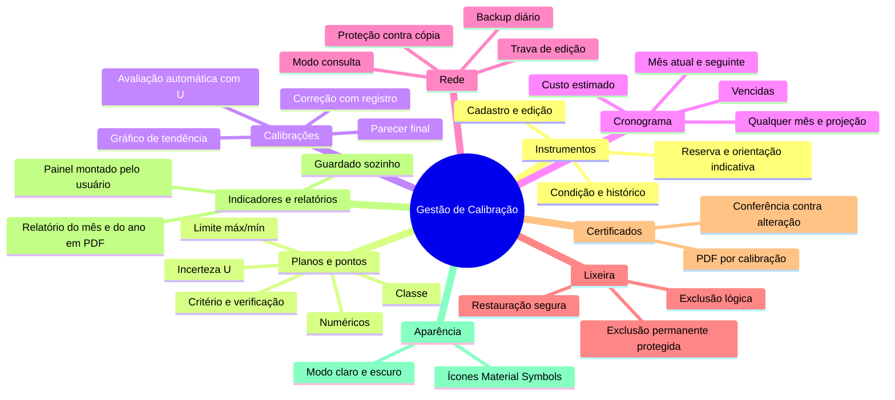

### 🎯 Objetivos

| | Objetivo |
|---|---|
| 💻 | Digitalizar o gerenciamento de calibrações. |
| 🗂️ | Organizar os cadastros de equipamentos e seus respectivos tipos. |
| 📐 | Estruturar planos e pontos de calibração. |
| 🕓 | Centralizar os registros e o histórico das calibrações. |
| 🔎 | Facilitar a consulta e a manutenção das informações. |
| 📉 | Reduzir a dependência de planilhas extensas e de operações manuais. |
| 🔗 | Melhorar a organização e a rastreabilidade das informações técnicas. |

## 📊 Em números

| | Número | O que significa |
|---|---|---|
| 🧪 | **410 testes automáticos** | Regras, banco, importador e telas testados com dados fictícios (pytest; telas em modo *offscreen*). |
| 🐍 | **~11.000 linhas** de código + **~5.100** de testes | Programa final escrito do zero, em camadas. |
| 🔀 | **20 pull requests** em **6 fases** + 2 versões de melhorias | Cada fase numa branch própria, revisada e aprovada antes de juntar. |
| 🏷️ | **3 versões entregues** (`v1.0.0`, `v1.1.0`, `v1.2.0`) | Versionamento semântico, versão visível na tela. |
| 📝 | **3 decisões de arquitetura** (ADRs) | Troca para PySide6, trava de edição em rede, lugar oficial do banco. |
| 🗄️ | **9 versões da estrutura do banco** | Atualização automática do banco antigo, sem perder dados. |
| ⚡ | **~2 s** para abrir pela rede | Antes, 10–15 s. |
| 💾 | **2,4 MB** com 20 anos simulados | 2.000 calibrações; cronograma em 0,014 s. |

## 📸 Telas

> Imagens geradas com um **banco de dados fictício** (instrumentos, locais, fabricantes e pessoas
> inventados), sem nenhuma informação real.

<p align="center">
  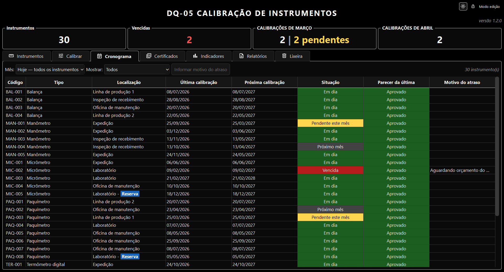
  <br/><em>Tela inicial: indicadores do mês e cronograma de todos os instrumentos, com a situação
  de cada um (em dia, pendente, vencida) e o motivo do atraso.</em>
</p>

<table>
  <tr>
    <td width="50%" align="center">
      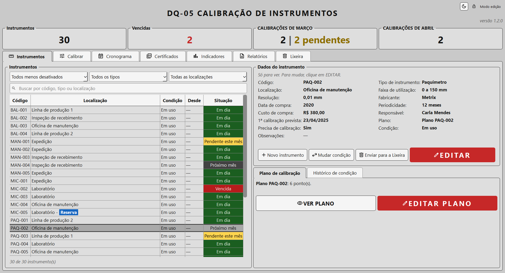
      <br/><em>Cadastro: lista com filtros, ficha do instrumento e plano de calibração.</em>
    </td>
    <td width="50%" align="center">
      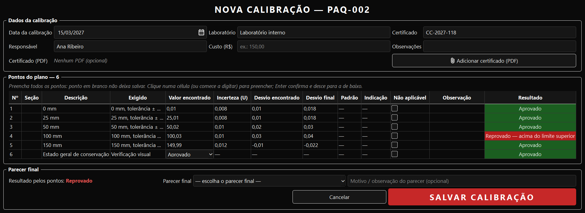
      <br/><em>Nova calibração: cada ponto é avaliado na hora, considerando a incerteza (U) —
      o ponto 4 reprova porque a faixa medida ± U passa da tolerância.</em>
    </td>
  </tr>
  <tr>
    <td width="50%" align="center">
      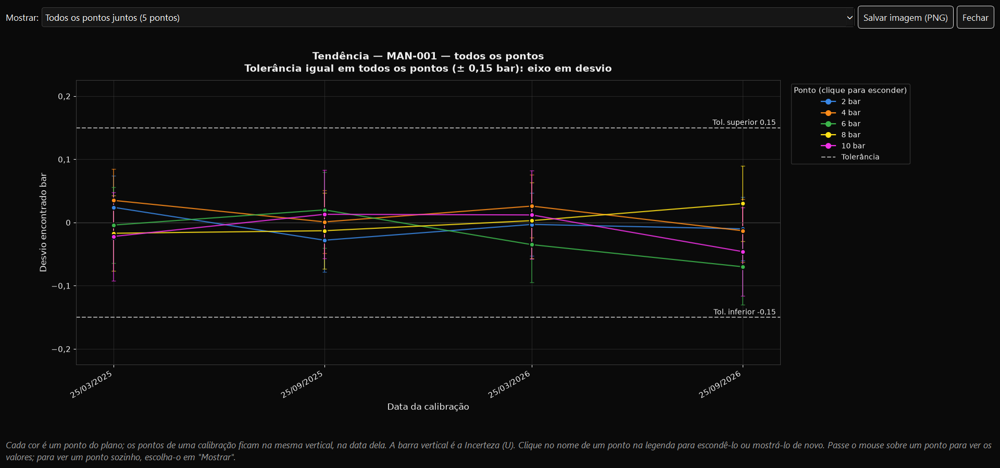
      <br/><em>Gráfico de tendência: desvio de cada ponto ao longo das calibrações, com a barra
      da incerteza e as linhas de tolerância.</em>
    </td>
    <td width="50%" align="center">
      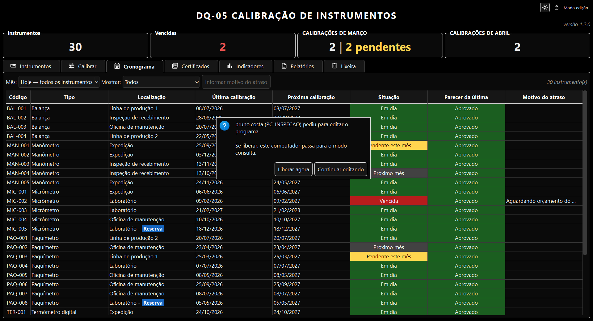
      <br/><em>Uso em rede: quem abre primeiro edita; outro computador entra em modo consulta e
      pode pedir a edição.</em>
    </td>
  </tr>
  <tr>
    <td colspan="2" align="center">
      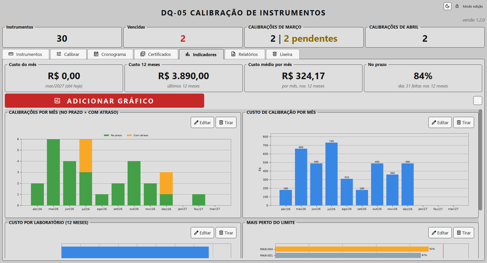
      <br/><em>Versão 1.2.0: painel de indicadores montado pelo usuário (custo, prazo, laboratórios,
      instrumentos mais perto do limite), aqui no modo claro — cada pessoa escolhe claro ou escuro.</em>
    </td>
  </tr>
</table>

## ✨ Funcionalidades

<table>
  <tr>
    <td valign="top" width="33%">

**🔧 Instrumentos e planos**

- Cadastro, edição e desativação de instrumentos, com filtros por condição, tipo e localização.
- Condição (**em uso** / **desativado**) com histórico de datas e motivos.
- Marcas **Reserva** e **Orientação indicativa**, com as cores das etiquetas físicas.
- Planos com pontos **numéricos, de limite, de classe, de critério e de verificação visual**.
- Ver × editar separados: nada muda sem clicar em **EDITAR**.

</td>
    <td valign="top" width="33%">

**📏 Calibrações**

- Registro com o resultado de cada ponto **enquanto se digita**, considerando a incerteza (U).
- Colunas de **desvio encontrado** e **desvio final** (desvio ± U).
- **Parecer final** de quem analisa, que muda a condição do instrumento.
- **Correção** de calibração salva, com registro de quem, quando e o que mudou.
- **Gráfico de tendência** com todos os pontos ou um por vez, exportável em PNG.

</td>
    <td valign="top" width="33%">

**📅 Cronograma e rede**

- Cronograma **por mês**: vencidas, pendentes, feitas e próximas.
- Qualquer mês, com **projeção** pela periodicidade e **custo estimado**.
- **Motivo do atraso**, registrado sem alarde.
- **Trava de edição** para vários computadores, **modo consulta** e pedido de edição.
- **Backup diário**, proteção contra cópia do banco e **Lixeira**.

</td>
  </tr>
  <tr>
    <td valign="top" width="33%">

**📄 Certificados**

- **PDF do certificado** anexado na calibração (opcional, um por calibração, trocável).
- Aba **Certificados**: código, nº do certificado e data; abre com um clique.
- PDF **conferido contra alteração**: se alguém mexer no arquivo, aparece aviso.

</td>
    <td valign="top" width="33%">

**📊 Indicadores e relatórios**

- **Painel montado pelo usuário**, como num BI: escolhe o que ver, como separar e o tipo de gráfico.
- Custo do mês, 12 meses e médio, **% no prazo**, custo por laboratório, **mais perto do limite**.
- **Relatório do mês em PDF** (números, gráficos, calibrações e ALTERAÇÕES), guardado sozinho.
- **Relatório do ano** com os números e os gráficos do painel.

</td>
    <td valign="top" width="33%">

**🎨 Cadastro e aparência**

- **Modo claro e escuro**, escolhido por cada pessoa, trocado na hora.
- Tipo e localização **com sugestões** (sem ligar para maiúsculas e acentos): nada de nome repetido.
- Código com **próximo número** da sigla (PAQ-018 → PAQ-019).
- Ícones **Material Symbols** e calendário em todos os campos de data.

</td>
  </tr>
</table>

Na tela principal, quatro indicadores dão a visão do mês — clicar em um deles abre a lista dos
instrumentos daquele grupo —, seguidos das abas de trabalho:

| Indicador | O que mostra |
|---|---|
| **Instrumentos** | Total de instrumentos em uso cadastrados. |
| **Vencidas** | Instrumentos cuja calibração estava prevista para um mês que já terminou. |
| **Calibrações de [mês]** | Previstas no mês atual e quantas ainda estão pendentes ("3 \| 2 pendentes"). |
| **Calibrações de [mês seguinte]** | Previstas para o próximo mês, para planejar com antecedência. |

| Aba | Recursos |
|---|---|
| 🔧 **Instrumentos** | Lista com filtros e busca, ficha do instrumento (só para ver; **EDITAR** abre a edição), plano de calibração (**VER PLANO** / **EDITAR PLANO**) e histórico de condição. |
| 📏 **Calibrar** | A mesma lista, o botão **NOVA CALIBRAÇÃO** e as calibrações feitas; cada uma abre para ver, com **EDITAR**, gráfico de tendência e envio para a Lixeira. |
| 📅 **Cronograma** | Situação de cada instrumento hoje ou em qualquer mês, parecer da última calibração, custo e motivo do atraso. |
| 📄 **Certificados** | PDFs dos certificados das calibrações feitas no programa, com pesquisa e botão **Abrir certificado**. |
| 📊 **Indicadores** | Números do mês e dos 12 meses + gráficos do painel; **ADICIONAR GRÁFICO** abre o montador com prévia; desfazer as últimas mudanças. |
| 📑 **Relatórios** | Relatório do mês atual (muda a cada calibração), relatório do ano e a lista dos relatórios finais guardados. |
| 🧺 **Lixeira** | Busca, restauração e exclusão permanente protegida do que foi registrado por engano. |

### 🧺 Lixeira

Nada é apagado direto: excluir manda para a **Lixeira** (exclusão lógica), de onde se restaura ou se
exclui de vez.

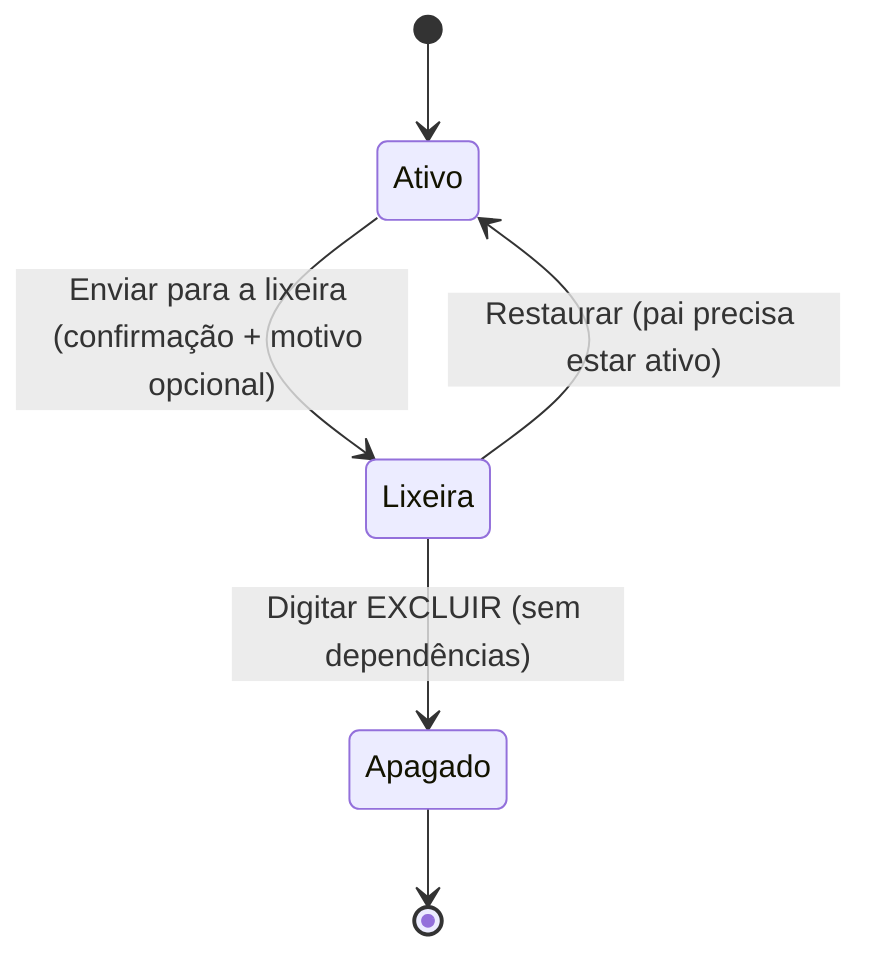

- Restaurar exige que o "pai" esteja ativo (o plano para os pontos, o instrumento para as calibrações).
- Excluir de vez só digitando **EXCLUIR**, e nunca o que tem dependências; calibração registrada por
  engano **pode** ser excluída de vez (leva junto os pontos medidos).
- Calibração enviada à Lixeira **desfaz** a mudança de condição que o parecer dela tinha feito;
  restaurar refaz.

## 🧠 Como o resultado é avaliado

Cada ponto de calibração é avaliado considerando a **incerteza de medição (U)**: a faixa completa
`[valor − U, valor + U]` precisa ficar dentro dos limites do ponto.

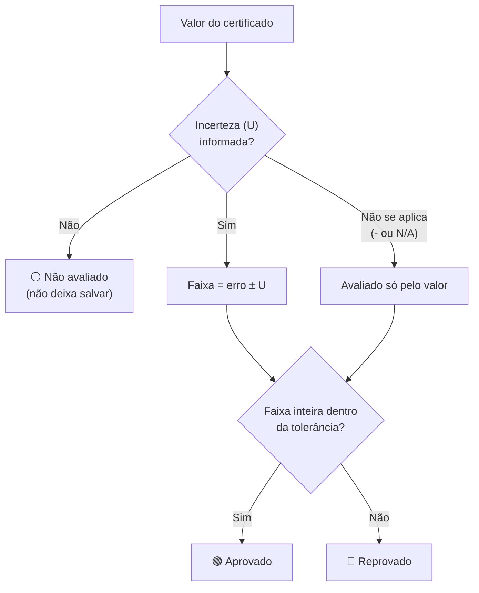

| Tipo de ponto | Como é avaliado |
|---|---|
| **Numérico com nominal** | `(medido − nominal) ± U` dentro da tolerância. |
| **Numérico sem nominal fixo** | Digita-se o **erro** do certificado (ex.: laboratório externo); erro ± U dentro da tolerância. |
| **Limite** | `medido + U ≤ máximo` e/ou `medido − U ≥ mínimo`. |
| **Classe, critério e verificação** | Quem calibra escolhe **Aprovado** ou **Reprovado**. |

O **desvio final** mostrado na tela é o desvio somado à U do lado mais perto da tolerância — é o número
que decide o resultado:

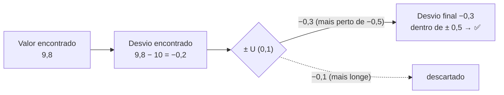

Depois dos pontos, **quem analisa** decide o parecer final:

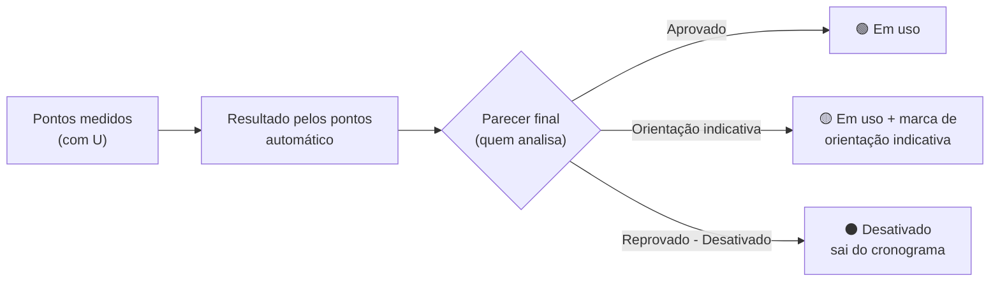

| Cor | Situação |
|---|---|
| 🟢 Verde | Aprovado / feito / em dia |
| 🔴 Vermelho | Reprovado / vencido / erro |
| 🟡 Amarelo | Pendência / aviso / não avaliado |
| ⚪ Cinza | Estados sem avaliação |

> [!NOTE]
> Pontos numéricos sem incerteza preenchida **não** são calculados como se a incerteza fosse zero —
> salvar é bloqueado até a U ser informada. Cada calibração guarda uma **"foto" do plano** do dia em que
> foi feita: corrigir o plano depois não altera calibrações antigas.

## 🧱 Arquitetura

O programa segue uma arquitetura em camadas: a **tela** não conhece SQL, e as **regras** não conhecem
nem a tela nem o banco — por isso são testadas sozinhas.

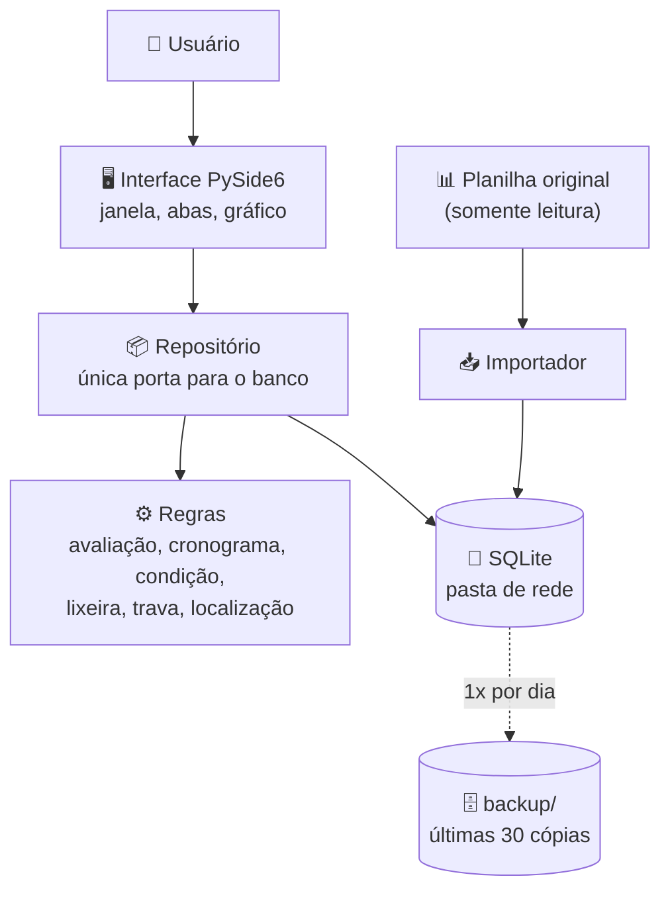

Distribuição na rede, sem servidor:

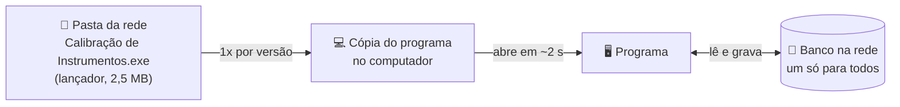

| Tecnologia | Aplicação no projeto |
|---|---|
| Python | Implementação das regras, do banco e da interface. |
| PySide6 | Interface desktop nativa, sem servidor nem navegador; tema escuro padronizado. |
| SQLite | Banco preparado para pasta de rede (journal tradicional, espera automática, backup diário). |
| Matplotlib | Gráfico de tendência embutido na janela (exportável em PNG) e gráficos do painel de indicadores, na janela e nos relatórios. |
| QPdfWriter (Qt) | Relatórios mensais e anuais em PDF, em folha A4, sem programa extra. |
| Material Symbols | Ícones do Google (licença Apache 2.0), repintados na cor do tema claro ou escuro. |
| openpyxl | Leitura da planilha de cronograma original, incluindo o formato de exibição das células. |
| PyInstaller | Empacotamento em `.exe` (lançador leve + programa em pasta). |
| pytest + ruff | Testes automáticos com dados fictícios e padronização do código. |
| Git + GitHub | Branch e pull request por fase, tags de versão, decisões registradas em ADRs. |
| Claude Code | Desenvolvimento assistido por IA: regras definidas e cada etapa aprovada pelo autor. |

## 💾 Modelo de dados

Principais tabelas do programa final (estrutura na versão 9, atualizada sozinha a cada versão; as
tabelas da 1.2.0 entraram sem mudar a versão, para a versão anterior ainda abrir o banco):

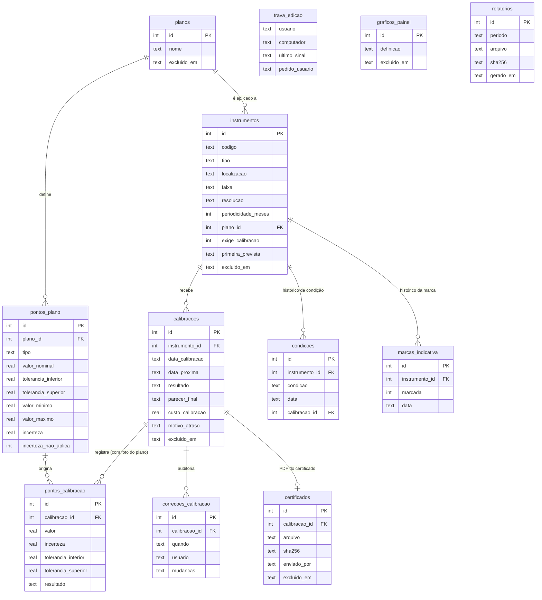

> [!TIP]
> As colunas `excluido_em` e `motivo_exclusao` implementam a Lixeira por **exclusão lógica**; a tabela
> `trava_edicao` tem no máximo uma linha: quem está editando agora.

## 🛠️ Como foi desenvolvido

| Prática | Como foi aplicada |
|---|---|
| 🧭 **Fases com entrega** | Roteiro em 6 fases; cada uma numa **branch** com **pull request**, juntada só depois de aprovada. |
| 📸 **Aprovação por foto** | Cada mudança de tela gerou "fotos" da janela (sem abri-la) para o usuário aprovar antes de seguir. |
| 🧪 **Testes primeiro nas regras** | Regras de avaliação, cronograma e lixeira refeitas do zero com testes; dados sempre fictícios. |
| 📝 **Decisões registradas** | Escolhas de arquitetura em ADRs (`docs/decisoes/`): o porquê fica guardado. |
| 🏷️ **Versionamento semântico** | `0.x` durante o desenvolvimento (uma versão por fase), `1.0.0` na entrada em uso, tag Git por versão. |
| 🧑‍🔬 **Teste de uso real** | Antes da entrega, uma cópia de teste foi usada de verdade; cada achado virou correção. |
| 🔒 **Dados protegidos** | A planilha original só é lida (de uma cópia, conferida por SHA-256); nenhum dado real no repositório. |
| 🤖 **IA como ferramenta** | Desenvolvimento com Claude Code: o autor define as regras de negócio, revisa e aprova cada etapa. |

### 🗺️ Roteiro

- [x] Fase 0 — Fundação (estrutura, versão, testes, decisões de arquitetura)
- [x] Fase 1 — Importador da planilha + relatório de conferência
- [x] Fase 2 — Regras de avaliação, cronograma, lixeira e desativação, com testes
- [x] Fase 3 — Banco preparado para uso em rede, com backup automático
- [x] Fase 4 — Interface PySide6 (condição do instrumento, parecer final, gráfico de tendência,
  lixeira e trava de edição para uso em rede)
- [x] Fase 5 — Melhorias e correções (plano novo pela tela, correção de calibração com registro,
  cronograma de qualquer mês com custo estimado, motivo do atraso, proteção contra cópia)
- [x] Fase 6 — Programa para a rede, teste de uso real e versão `1.0.0` em uso na empresa (novembro de 2026)
- [x] Versão `1.1.0` — ajustes do primeiro uso real (teclado, colunas de desvio, gráfico, calendário)
- [x] Versão `1.2.0` — certificados em PDF, modo claro e escuro, painel de indicadores, relatórios
  mensais e anuais, cadastro sem nomes repetidos

## 🔄 Do protótipo ao programa final

O sistema nasceu como um **protótipo em Streamlit** ([descrito abaixo](#-protótipo-streamlit)), feito
com apoio do ChatGPT, que precisava abrir um servidor local e o navegador. O **programa final** foi
refeito do zero como **aplicativo desktop em PySide6**, usando o protótipo como referência de regras e
funcionalidades, com a mesma identidade visual dos demais programas internos (tema escuro, layout em
faixas, versão na tela) — e está **em uso na empresa desde novembro de 2026**.

<details open>
<summary><b>📥 Fase 1 — Importador da planilha</b></summary>

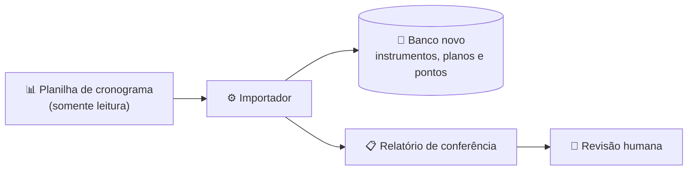

**Fase 1 — Importador da planilha.** O programa substitui uma planilha de cronograma grande e difícil de
manter. O importador lê a planilha **sem alterá-la** e monta o banco novo com tudo o que é preciso para
fazer **novas** calibrações:

- instrumentos ativos (desativados ficam de fora; instrumentos sem plano entram mesmo assim);
- planos com pontos **numéricos, de limite, de classe, de critério e de verificação visual**;
- tolerâncias lidas também pelo **formato de exibição da célula** (ex.: `0.007` exibido como `± 0,007`);
- incerteza (U) de cada ponto vinda da **calibração mais recente** que a informa;
- relatório para conferência humana, com o que entrou, o que ficou de fora e o motivo.

O banco começa **sem calibrações**: o histórico antigo continua na planilha, só para consulta.
</details>

<details>
<summary><b>⚙️ Fase 2 — Regras de negócio, refeitas do zero com testes</b></summary>

**Fase 2 — Regras de negócio, refeitas do zero com testes.** As regras ficam numa camada própria, que
não conhece a tela nem o banco, e cada uma foi definida junto com quem usa o sistema no dia a dia.

| Regra | O que mudou em relação ao protótipo |
|---|---|
| Avaliação por ponto com a incerteza (U) | Passa a cobrir pontos de **limite** (máx./mín.) e pontos **sem nominal fixo**, avaliados pelo erro informado no certificado do laboratório externo. |
| Resultado geral da calibração | Ponto em branco **não é mais ignorado**: a calibração só é salva com todos os pontos preenchidos ou marcados como "não aplicável", com motivo. "Aprovado com restrição" passa a se chamar **"Aprovado como orientação indicativa"**, o termo usado na empresa. |
| Cronograma | Acompanhamento **por mês**, como a empresa trabalha (dia 1 ao último dia): o que está previsto vira "pendente este mês" e só conta como vencido quando o mês termina; no lugar de "próximos 30 dias" entra "próximo mês". Novo grupo **"Sem calibração no programa"**, que acompanha a transição da planilha até todos os instrumentos terem a primeira calibração registrada. |
| Lixeira | Calibração registrada por engano **pode** ser excluída permanentemente. |
| Desativação | Novo: instrumento que deixou de ser usado vai para **Desativados**, com motivo e data, e pode ser **reativado** sem perder o histórico. |

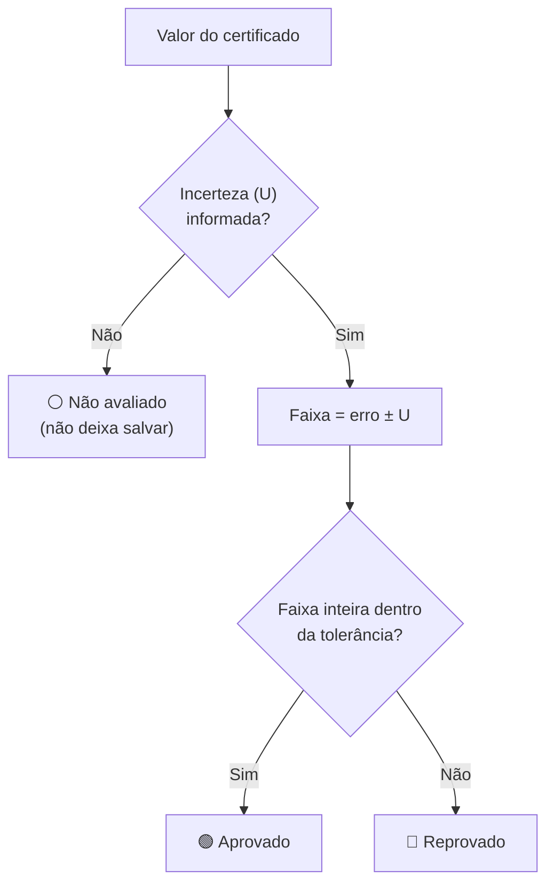
</details>

<details>
<summary><b>🌐 Fase 3 — Banco para uso em pasta de rede</b></summary>

**Fase 3 — Banco para uso em pasta de rede.** O programa fica numa pasta compartilhada, sem servidor,
e às vezes é aberto por mais de uma pessoa. O banco foi preparado para isso:

| Cuidado | Como foi resolvido |
|---|---|
| Um só lugar fala com o banco | **Classe repositório**: a tela nunca escreve SQL; trocar de banco no futuro muda um único arquivo. |
| Pasta de rede | Modo de diário tradicional do SQLite (o modo WAL não funciona em rede), espera automática quando outra pessoa está gravando e transações curtas. |
| Perda de dados | **Backup diário automático**, feito antes de qualquer atualização da estrutura; guarda as 30 cópias mais recentes e nunca deixa uma cópia "pela metade". |
| Histórico confiável | Cada calibração guarda uma **"foto" dos pontos do plano** (nominal, tolerância, incerteza) do dia em que foi feita: corrigir o plano depois não altera calibrações antigas. |
| Atualizações do programa | O banco antigo é **atualizado sozinho** para a estrutura nova, sem perder dados. |

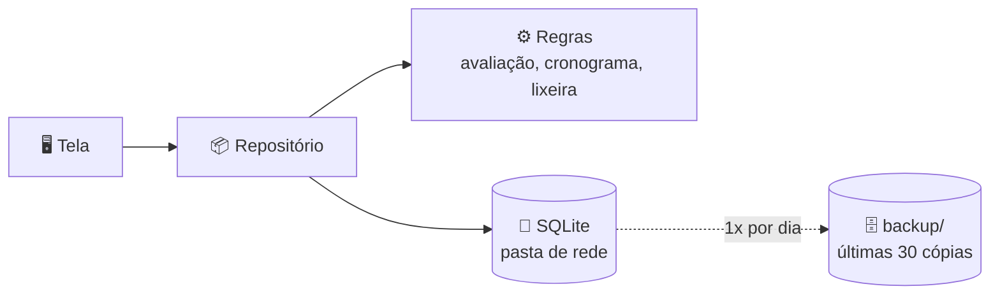
</details>

<details>
<summary><b>🖥️ Fase 4 — Interface desktop em PySide6</b></summary>

**Fase 4 — Interface desktop em PySide6.** O programa ganhou a tela nova, com a mesma identidade
visual dos demais programas internos: tema escuro, layout em faixas, logo, versão na tela e cores
com significado fixo (verde = certo, vermelho = problema, amarelo = aviso). Nas localizações,
"Orientação indicativa" imita a etiqueta física (vermelho sobre amarelo) e "Reserva" aparece em azul.

| Tela | O que faz |
|---|---|
| **Topo** | Total de instrumentos, vencidas e o acompanhamento **por mês** ("calibrações de outubro: 3 \| 2 pendentes" e as do mês seguinte). Clicar num painel abre uma lista flutuante com os instrumentos daquele grupo. |
| **Instrumentos** | Lista com filtros por **condição**, **tipo** e **localização** ("clico em paquímetro e aparecem todos os paquímetros"), ficha do instrumento (com custo de compra e responsável) e três sub-abas: plano, calibrações e histórico de condição. |
| **Plano de calibração** | Pontos editáveis direto na tabela; aviso em amarelo para os pontos sem incerteza (U). Mudar o plano vale daqui para a frente: calibrações antigas guardam a "foto" do plano usado. |
| **Calibrações** | Registro em tela cheia: o resultado de cada ponto aparece **enquanto se digita**, sempre considerando a incerteza (U); depois, quem analisa escolhe o **parecer final**. Histórico, ver os pontos de cada calibração e **gráfico de tendência**. |
| **Cronograma** | Situação de cada instrumento no mês, com filtro e o parecer da última calibração. |
| **Lixeira** | Restaurar o que foi registrado por engano ou excluir de vez (só digitando EXCLUIR). |

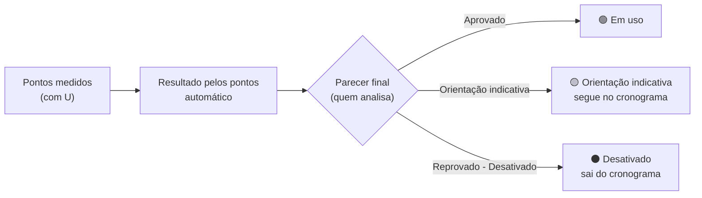

| Novidade | O que mudou |
|---|---|
| **Condição do instrumento** | No lugar da aba "Desativados": cada instrumento está **em uso**, como **orientação indicativa** ou **desativado**, com histórico (data, observação e se veio de uma calibração ou de uma mudança manual). |
| **Parecer final** | O resultado dos pontos é calculado sozinho; o parecer é decisão de quem analisa e **muda a condição** do instrumento. Calibração reprovada nos pontos não pode receber "Aprovado". Enviar a calibração à Lixeira desfaz essa mudança. |
| **Gráfico de tendência** | Um ponto do plano por vez: o erro de cada calibração com a barra da incerteza (U) e as linhas de tolerância — o ponto só é aprovado se a barra inteira ficar dentro. Ponto reprovado em vermelho, valores ao passar o mouse e exportação em PNG. |
| **Uso por várias pessoas na rede** | **Trava de edição**: quem abre primeiro edita; os outros entram em modo consulta (botões de mudar escondidos, campos travados, dados se atualizando sozinhos). Um texto discreto no canto mostra o modo e quem está editando; clicar nele **pede a edição**, e quem edita escolhe liberar ou continuar. A trava se libera sozinha se o computador travar ou ficar 30 minutos parado. |
| **Desempenho** | Medido com 20 anos de uso simulado (2.000 calibrações): banco com **2,4 MB** e cronograma calculado em **0,014 s** — o oposto da planilha, que travava por excesso de abas e fórmulas. |

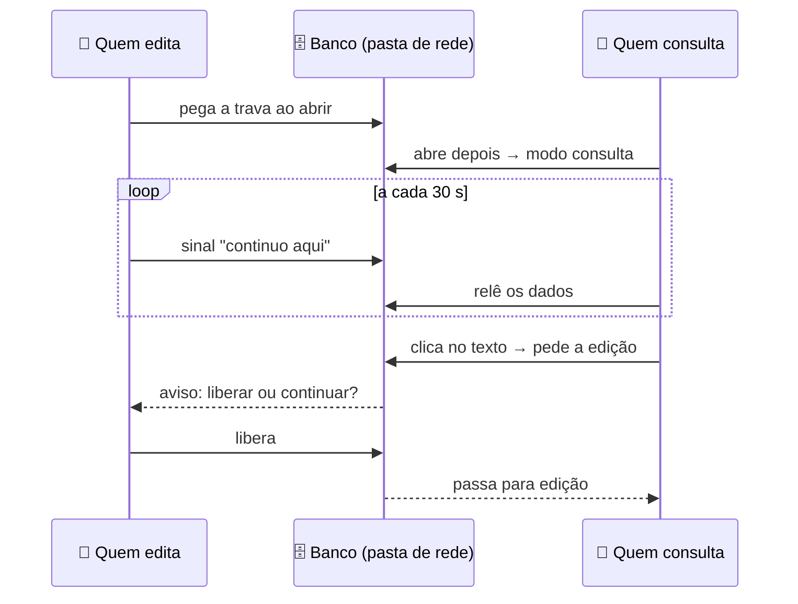
</details>

<details>
<summary><b>✨ Fase 5 — Melhorias e correções</b></summary>

**Fase 5 — Melhorias e correções**, comparando funcionalidade por funcionalidade com
o protótipo:

| Melhoria | O que faz |
|---|---|
| **Plano novo pela tela** | Botão "Novo plano" na ficha do instrumento: cria o plano e já o escolhe; plano criado por engano vai para a Lixeira e continua aparecendo como "(na Lixeira)" até ser restaurado ou trocado. |
| **Pesquisa na Lixeira** | Busca por código, descrição ou motivo. |
| **"Reserva" em azul** | Assim como a "Orientação indicativa" imita a etiqueta física, "Reserva" aparece em azul com letra branca. |
| **Corrigir calibração salva** | Valores, incerteza (U), parecer e dados do certificado podem ser corrigidos (a data não). O resultado é reavaliado pela "foto" do plano guardada na calibração, a condição do instrumento acompanha o parecer, e **cada correção fica registrada** — quando, quem e o que mudou ("antes → depois") — para auditoria. |
| **Proteção contra cópia** | A trava de edição só funciona entre quem abre o mesmo arquivo. Por isso o banco guarda o seu lugar oficial: aberto de uma pasta copiada, o programa fica só em consulta e avisa onde está o oficial (a mesma pasta da rede vista por letra de unidade ou por `\servidor` não conta como cópia). E nunca cria um banco vazio sem avisar. |
| **Cronograma de qualquer mês** | Seletor de 12 meses para trás a 24 para a frente: o que estava previsto, quando foi feito e, nos meses futuros, a **projeção pela periodicidade** de cada instrumento. |
| **Custo estimado do mês** | Soma do último custo de calibração de cada instrumento previsto — ajuda a planejar o orçamento das calibrações externas. |
| **Motivo do atraso** | Para a calibração vencida, informa-se por que ainda não foi feita; ao registrá-la, o motivo vai junto. O atraso fica registrado sem alarde — às vezes não é culpa de ninguém. |
</details>

<details>
<summary><b>🚀 Fase 6 — Programa pronto para a rede e versão 1.0.0</b></summary>

**Fase 6 — Programa pronto para a rede e versão `1.0.0`.** Antes de entrar em uso, o programa
passou por um **teste de uso real** numa cópia separada (o "programa de TESTE", com faixa amarela,
para mexer à vontade sem bagunçar o banco oficial). Cada achado virou uma correção, mostrada por
foto e aprovada antes de seguir:

| Melhoria | O que faz |
|---|---|
| **Abre rápido pela rede** | Na pasta da rede só se vê um `.exe` pequeno: ele copia o programa para o computador uma vez por versão e abre de lá em ~2 s (antes, 10–15 s). Atualizar = trocar uma pasta. |
| **Aba Calibrar** | Lugar próprio para calibrar: a lista de instrumentos, o botão **NOVA CALIBRAÇÃO** e as calibrações feitas; cada uma abre só para ver, com **EDITAR** à parte. |
| **Ver × editar** | Ficha do instrumento e plano de calibração são **só apresentação**; para mudar, botões **EDITAR** abrem janelas próprias com faixa amarela "Você está editando" — ninguém altera nada sem querer. |
| **Tudo o que é clicável se mostra** | Passar o mouse clareia botões, abas, filtros e células; o código na lista é um botão; caixinhas com contorno; aviso verde **"✔ Salvo"** a cada gravação. |
| **Marcas Reserva e Orientação indicativa** | Caixinhas na ficha; a orientação indicativa deixou de ser "condição" e virou uma marca a mais, com histórico. |
| **1ª calibração prevista** | O programa começa sem calibrações antigas, mas cada instrumento recebe a data da próxima calibração e **já entra no cronograma**. |
| **Incerteza "não se aplica"** | Onde a planilha diz "-" ou "N/A", o ponto é avaliado só pelo valor — diferente de incerteza esquecida, que continua bloqueando. |
| **Dois computadores** | No modo consulta, botões **Pedir edição** e **Atualizar** no canto; a resposta volta em **verde** (liberado) ou **vermelho** (recusado); a tela se atualiza sozinha a cada 10 s. |
| **Gráfico de tendência com todos os pontos** | Abre com **todos os pontos juntos**, cada um com sua cor. Tolerâncias iguais → eixo no desvio; diferentes → eixo em **% da tolerância usada** (100% = no limite). Clicar no nome do ponto na legenda esconde/mostra; um ponto por vez continua disponível, na medida normal. |
| **Cronograma a partir da implantação** | O seletor de mês começa no mês atual e nos próximos; os meses que já passaram ficam embaixo, como registro, sem nada de antes da implantação. |
| **Rolagem** | Roda do mouse só rola (nunca muda opção sem querer); **Shift + roda** rola para os lados. |
</details>

<details>
<summary><b>🔧 Versão 1.1.0 — o que o primeiro uso real ensinou</b></summary>

**Versão `1.1.0` — o que o primeiro uso real ensinou.** Na primeira calibração registrada na
empresa apareceram ajustes, feitos e aprovados por foto:

| Melhoria | O que faz |
|---|---|
| **Nada se perde com o teclado** | Enter e Esc não fecham mais nenhuma janela (o Enter fechava a calibração e o que estava digitado se perdia): só fecham pelo **X**, por **Salvar** ou por **Cancelar**. |
| **Enter igual ao Excel** | Nas tabelas, o Enter confirma o valor e desce para a célula de baixo, já pronta para digitar. |
| **Desvio separado do valor** | A calibração mostra **Valor encontrado**, **Incerteza (U)**, **Desvio encontrado** (encontrado − exigido) e **Desvio final**: o desvio somado à U do lado mais perto da tolerância (ex.: desvio −0,2 e U 0,1 → −0,3). É o número que decide o resultado. |
| **Gráfico com as datas certas** | Os pontos de uma calibração ficam na mesma vertical, e embaixo aparecem as datas das próprias calibrações; até 17 pontos, cada um com uma cor bem diferente. |
| **Calendário no tema escuro** | O calendário das datas estava branco com os dias em branco; agora segue o tema. |


</details>

<details>
<summary><b>📊 Versão 1.2.0 — certificados, indicadores, relatórios e modo claro</b></summary>

**Versão `1.2.0` — a maior desde a entrega.** Com o programa em uso, vieram as novidades pedidas
pelo dia a dia da Qualidade, cada uma aprovada por foto e testada numa cópia do banco real antes de
ir para a rede:

| Novidade | O que faz |
|---|---|
| **Certificados em PDF** | Na nova calibração (ou no EDITAR) escolhe-se o PDF do certificado; ele é copiado para a pasta do programa e conferido por SHA-256. Trocar manda o anterior para a Lixeira. Aba **Certificados** com pesquisa e botão **Abrir certificado**; PDF mexido depois abre com aviso amarelo. |
| **Modo claro e escuro** | Botão sol/lua no canto: cada pessoa escolhe, a troca é na hora e fica guardada por usuário do Windows. No claro, o logo ganha letra preta. |
| **Painel de indicadores** | Montado pelo próprio usuário, sem IA: **ADICIONAR GRÁFICO** abre um montador com listas (o que ver, separado por, só os que…, cores, período, tipo de gráfico) e prévia na hora; o montador só oferece o que faz sentido e não deixa adicionar gráfico vazio. Um painel só para todos, guardado no banco; desfazer as 3 últimas mudanças. |
| **Relatórios em PDF** | Relatório do mês atual (muda a cada calibração) e, no primeiro dia do mês novo, o **relatório final** do mês anterior é criado e guardado **sozinho**, conferido por SHA-256. Mês: números, gráficos do painel, calibrações e ALTERAÇÕES. Ano: números e gráficos. |
| **Cadastro sem nomes repetidos** | Tipo e localização com sugestões enquanto se digita, sem ligar para maiúsculas e acentos; nome novo pede confirmação; nomes parecidos já existentes no banco foram juntados uma vez, ao abrir. |
| **Código com sigla** | Lista "Tipo (SIGLA)" no campo do código e o **próximo número** já preenchido; código repetido em vermelho na hora. |
| **Detalhes** | Título com o código do documento (DQ-05), ícones Material Symbols, calendário em toda data, dinheiro com centavos, linha inteira da lista clicável, botão para renomear plano. |

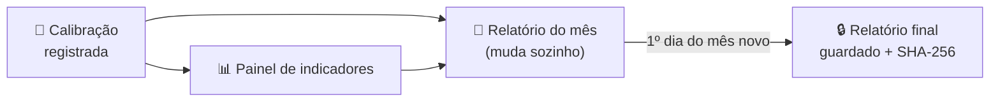
</details>

## 🧪 Protótipo (Streamlit)

O protótipo continua no repositório como registro da história do projeto. Abaixo, como ele era.

<details>
<summary><b>🗺️ Mapa do protótipo</b></summary>

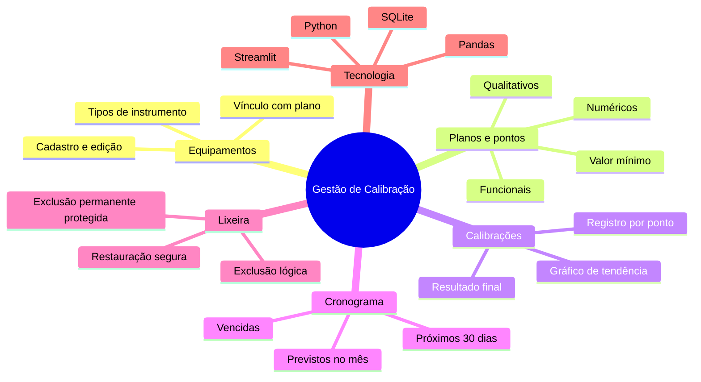
</details>

<details>
<summary><b>✨ Funcionalidades e telas do protótipo</b></summary>

<table>
  <tr>
    <td valign="top" width="33%">

**🔧 Gestão de Equipamentos**

- Cadastro e gerenciamento de equipamentos.
- Organização por tipos de equipamento.
- Associação entre equipamentos e planos de calibração.
- Consulta das informações cadastradas.

</td>
    <td valign="top" width="33%">

**📐 Planos e Pontos de Calibração**

- Cadastro e organização de planos de calibração.
- Definição de pontos de calibração.
- Suporte a diferentes categorias de pontos: numéricos, qualitativos, funcionais e de valor mínimo.

</td>
    <td valign="top" width="33%">

**📚 Registros e Histórico**

- Registro das calibrações realizadas.
- Consulta dos registros armazenados.
- Organização dos dados para acompanhamento do histórico.
- Armazenamento persistente em banco de dados local.

</td>
  </tr>
</table>

Na tela principal, quatro indicadores dão a visão geral do parque de instrumentos, seguidos das abas de
trabalho:

| Indicador | O que mostra |
|---|---|
| **Equipamentos** | Total de equipamentos cadastrados. |
| **Calibrações** | Total de calibrações registradas. |
| **Vencidas** | Equipamentos cuja última calibração visível já passou da próxima data prevista. |
| **Próximas 30 dias** | Equipamentos com calibração prevista para os próximos 30 dias. |

| Aba | Recursos |
|---|---|
| 🔧 **Equipamentos** | Cadastro de equipamentos; gerenciamento de tipos, planos e pontos nominais; para cada equipamento, as subabas *Dados*, *Editar* e *Calibrações* (pontos, resultado final e gráfico de tendência com download em PNG). |
| 📅 **Cronograma** | Cronograma de calibração por equipamento, equipamentos previstos para o mês e lista de vencidas, com cores para realizado, vencido, próximo e em dia (meses em português). |
| 🧺 **Lixeira** | Busca, restauração e exclusão permanente protegida dos registros enviados à lixeira. |

**Como o resultado era avaliado no protótipo:**

Cada ponto de calibração é avaliado considerando a **incerteza de medição (U)**: a faixa completa
`[valor − U, valor + U]` precisa ficar dentro dos limites do ponto.

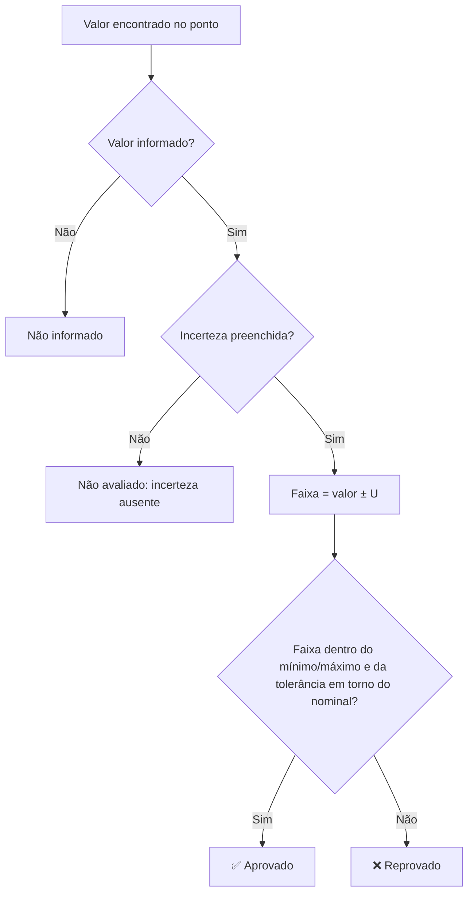

| Cor | Situação |
|---|---|
| 🟢 Verde | Aprovado |
| 🔴 Vermelho | Reprovado |
| 🟡 Amarelo | Pendência / restrição |
| ⚪ Cinza | Estados sem avaliação |

> [!NOTE]
> A cor é apenas visual: o resultado armazenado não é modificado por ela. Pontos numéricos sem incerteza
> preenchida **não** são recalculados como se a incerteza fosse zero — salvar valores que dependam da
> incerteza ausente é bloqueado e esses pontos são omitidos do gráfico, com aviso.
</details>

<details>
<summary><b>🧱 Arquitetura e tecnologias do protótipo</b></summary>

A aplicação segue uma arquitetura organizada em camadas, separando a interface, a lógica de
processamento e a persistência dos dados.

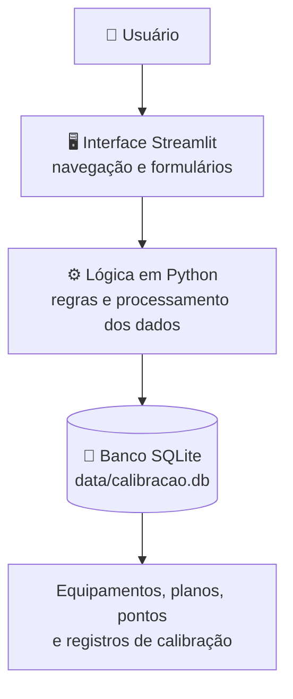

E como os arquivos do projeto se conectam:

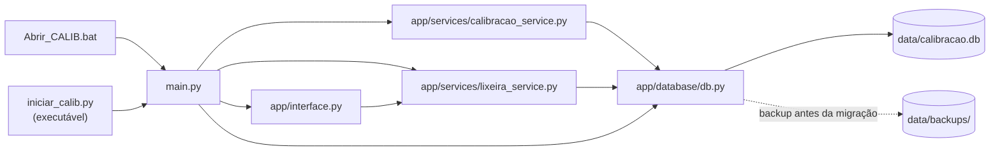

| Tecnologia | Aplicação no projeto |
|---|---|
| Python | Implementação da lógica e das regras da aplicação. |
| Streamlit | Construção da interface interativa. |
| SQLite | Armazenamento estruturado dos dados. |
| Pandas | Manipulação e organização de dados tabulares. |
| Matplotlib | Gráfico de tendência do equipamento, exportável em PNG. |
| PyInstaller | Empacotamento em executável para Windows (`Sistema_de_Calibracao.spec`). |
| unittest | Testes automáticos da lixeira e da migração. |
| Git | Controle de versão do código-fonte. |
| GitHub | Hospedagem e documentação do repositório. |
</details>

<details>
<summary><b>💾 Modelo de dados do protótipo</b></summary>

Tabelas criadas por `app/database/db.py` (principais campos):

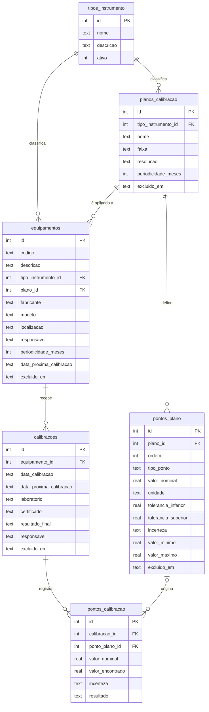

> [!TIP]
> As colunas `excluido_em` e `motivo_exclusao` (equipamentos, calibrações, planos e pontos dos planos)
> implementam a lixeira por **exclusão lógica**.
</details>

<details>
<summary><b>🧺 Lixeira do protótipo (regras, migração e backup)</b></summary>

> [!IMPORTANT]
> **Atualização: lixeira e resultados visuais.** Exclusão lógica, restauração segura, exclusão permanente
> protegida, resultados coloridos e melhorias no cronograma. A migração cria **backup automático** antes de
> adicionar os campos da lixeira.
>
> Consulte [as regras, os arquivos modificados e a validação](docs/ATUALIZACAO_LIXEIRA.md).

```mermaid
stateDiagram-v2
    [*] --> Ativo
    Ativo --> Lixeira: Enviar para a lixeira (confirmação + motivo opcional)
    Lixeira --> Ativo: Restaurar (pai precisa estar ativo)
    Lixeira --> Apagado: Digitar EXCLUIR (sem dependências)
    Apagado --> [*]
```

<details>
<summary><b>📜 Regras da lixeira</b> (clique para expandir)</summary>

- As ações **Enviar para a lixeira** aparecem na edição do equipamento, no cadastro/edição de planos e
  pontos e nos detalhes da calibração. Exigem confirmação e aceitam motivo opcional.
- Excluir um pai não envia os filhos individualmente à lixeira; vínculos e snapshots históricos continuam
  armazenados.
- Equipamento excluído oculta suas calibrações das operações; plano excluído impede novas calibrações e
  oculta seus pontos operacionais. Históricos já realizados continuam consultáveis.
- Restaure primeiro o plano (para restaurar pontos/equipamentos) e o equipamento (para restaurar suas
  calibrações). A restauração não reativa um registro que já estava inativo.
- A exclusão permanente exige digitar **EXCLUIR**. Calibrações nunca são apagadas permanentemente nesta
  versão; registros com histórico ou dependências não podem ser apagados. Não há exclusão em cascata.
- Os indicadores de vencimento usam a última calibração **visível** de cada equipamento; as datas
  originais armazenadas não são sobrescritas pela lixeira.

</details>

<details>
<summary><b>🛡️ Migração e backup</b></summary>

- Adiciona `excluido_em TEXT` e `motivo_exclusao TEXT` e cria índices; é transacional e pode ser
  executada novamente.
- Antes da primeira migração, a aplicação verifica integridade e chaves estrangeiras e salva uma cópia em
  `data/backups/calibracao_antes_lixeira_<data_hora>.db`. Se a cópia falhar, a migração não prossegue.
- O banco continua em `data/calibracao.db`.

</details>
</details>

<details>
<summary><b>🧪 Testes do protótipo</b></summary>

Os testes copiam o banco para diretórios temporários em `tests`, nunca executam exclusões no original e
conferem:

- preservação de todos os campos anteriores, inclusive incertezas, e migração idempotente;
- exclusão/restauração dos quatro tipos e vínculos originais;
- restauração bloqueada quando o pai está excluído;
- bloqueio de exclusões permanentes com histórico/dependências;
- confirmação, cancelamento e exclusão permanente permitida;
- filtros, pesquisa, mensagens e nova inicialização da aplicação;
- cores enviadas às células de resultado, cronograma e geração do gráfico;
- banco íntegro e sem violações de chaves estrangeiras.
</details>

## 📁 Estrutura do Repositório

```text
SistemaCalibracao/
├── src/calibracao/             # 🟢 programa final (PySide6)
│   ├── interface/              #    janela, abas, componentes, gráficos, relatórios em PDF, temas, ícones
│   ├── regras/                 #    avaliação, cronograma, condição, lixeira, trava, indicadores, relatório
│   ├── dados/                  #    repositório, estrutura do banco, backup, lugar oficial, certificados
│   ├── importacao/             #    leitura e interpretação da planilha original
│   └── lancador.py             #    .exe leve que abre o programa pela rede
├── tests/                      # 410 testes automáticos (pytest, dados fictícios)
├── empacotamento/              # geração do .exe e montagem do pacote de entrega
├── docs/
│   ├── decisoes/               # ADRs: decisões de arquitetura
│   └── telas/                  # fotos das telas (dados fictícios)
├── pyproject.toml              # versão, dependências, pytest e ruff
│
│   # 🧪 protótipo Streamlit (registro histórico)
├── app/                        # banco, serviços e interface do protótipo
│   ├── database/db.py          # conexão, criação do banco, migrações e backup
│   ├── services/               # calibrações, lixeira e incertezas de referência
│   └── interface.py            # cores semânticas e telas da lixeira
├── assets/                     # recursos da interface (logo)
├── scripts/                    # utilitários administrativos (importação, validação, limpeza)
├── main.py                     # ponto de entrada do protótipo
├── iniciar_calib.py            # inicializador do executável do protótipo
├── Abrir_CALIB.bat             # atalho do protótipo no Windows
├── Sistema_de_Calibracao.spec  # configuração do PyInstaller do protótipo
├── requirements.txt            # dependências do protótipo
├── .vscode/                    # configuração de execução no VS Code
└── README.md
```

> [!CAUTION]
> Os scripts antigos de correção/importação/limpeza são utilitários administrativos anteriores e **não**
> devem ser usados no fluxo normal de exclusão, que agora é a Lixeira.

## 🏅 Aplicações e Competências Demonstradas

| | Competência |
|---|---|
| 🐍 | Desenvolvimento de aplicações em Python. |
| 🖥️ | Construção de interfaces com Streamlit (protótipo) e desktop com PySide6 (programa final). |
| 🌐 | Uso simultâneo em pasta de rede sem servidor: trava de edição e banco preparado para rede. |
| 📈 | Visualização de dados técnicos (gráfico de tendência com incerteza e tolerância). |
| 📊 | Painel de indicadores configurável pelo usuário e relatórios automáticos em PDF. |
| 🎨 | Interface com tema claro e escuro trocado na hora e ícones padronizados. |
| 🗃️ | Modelagem e persistência de dados relacionais, com migração automática da estrutura. |
| 📐 | Metrologia aplicada: avaliação de conformidade considerando a incerteza de medição. |
| 🧪 | Testes automatizados e arquitetura em camadas, com regras independentes da tela. |
| 📥 | Migração de dados de planilha legada, fiel à origem e com relatório de conferência. |
| 📋 | Digitalização de processos de qualidade. |
| 🔗 | Organização e rastreabilidade de informações técnicas. |
| 🧩 | Estruturação de software para resolução de problemas operacionais. |
| 🤖 | Uso de IA (Claude Code) como ferramenta de desenvolvimento, com o autor no controle das regras. |

---

<p align="center">
  <b>Projeto de desenvolvimento de software aplicado à gestão da qualidade, com foco na organização de
  dados, digitalização de processos e melhoria da eficiência operacional.</b>
</p>
