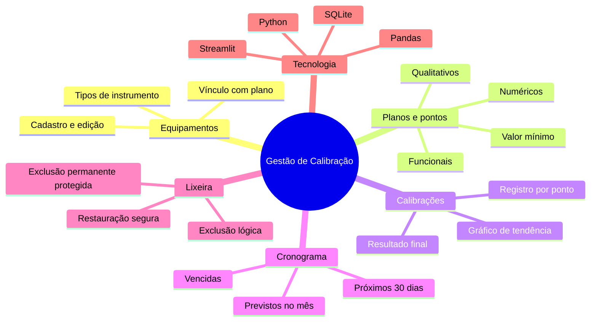
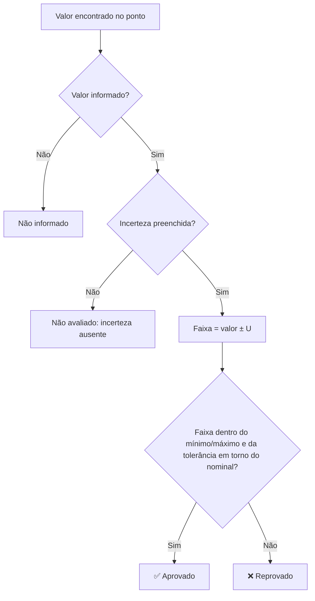
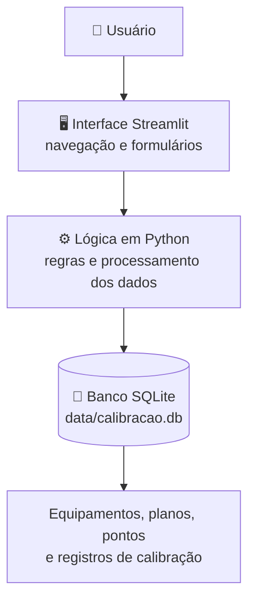
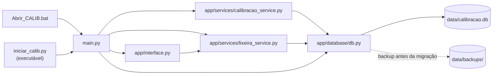
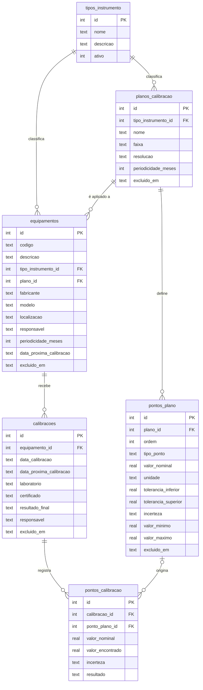
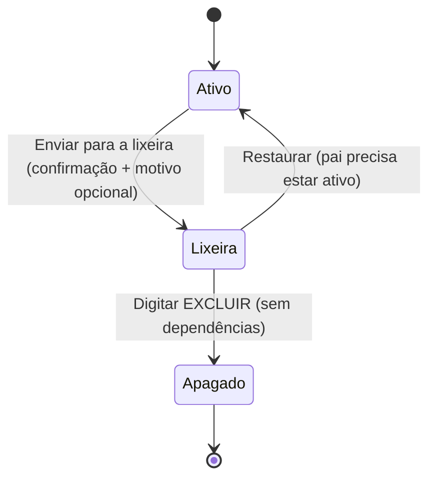
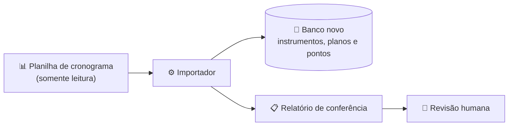

# Sistema de Gestão de Calibração

<p align="center">
  
  
  
  
  
</p>
<p align="center">
  
  
  
  
</p>
<p align="center">
  
  
  
  
</p>

<p align="center">
  Aplicação para digitalização e gerenciamento de processos de calibração, com organização de
  equipamentos, planos, pontos de medição e registros históricos.
</p>

<p align="center">
  <a href="#-visão-geral">Visão Geral</a> •
  <a href="#-funcionalidades">Funcionalidades</a> •
  <a href="#-como-o-resultado-é-avaliado">Como funciona</a> •
  <a href="#-arquitetura">Arquitetura</a> •
  <a href="#-modelo-de-dados">Modelo de dados</a> •
  <a href="#-lixeira">Lixeira</a> •
  <a href="#-do-protótipo-ao-programa-final">Programa final</a> •
  <a href="#-estrutura-do-repositório">Estrutura</a>
</p>

---

## 📌 Visão Geral

O **Sistema de Gestão de Calibração** estrutura e simplifica o gerenciamento de calibrações de
equipamentos, substituindo um fluxo de trabalho baseado em **planilhas extensas** por uma solução com
interface interativa e armazenamento estruturado.

A aplicação centraliza informações técnicas e registros operacionais, facilitando a consulta dos
equipamentos, a organização dos planos de calibração e o acompanhamento do histórico.

O projeto aplica conceitos de desenvolvimento de software, modelagem de dados, automação de processos
administrativos e melhoria contínua em um cenário relacionado à **gestão da qualidade**.



### 🎯 Objetivos

| | Objetivo |
|---|---|
| 💻 | Digitalizar o gerenciamento de calibrações. |
| 🗂️ | Organizar os cadastros de equipamentos e seus respectivos tipos. |
| 📐 | Estruturar planos e pontos de calibração. |
| 🕓 | Centralizar os registros e o histórico das calibrações. |
| 🔎 | Facilitar a consulta e a manutenção das informações. |
| 📉 | Reduzir a dependência de planilhas extensas e de operações manuais. |
| 🔗 | Melhorar a organização e a rastreabilidade das informações técnicas. |

## ✨ Funcionalidades

<table>
  <tr>
    <td valign="top" width="33%">

**🔧 Gestão de Equipamentos**

- Cadastro e gerenciamento de equipamentos.
- Organização por tipos de equipamento.
- Associação entre equipamentos e planos de calibração.
- Consulta das informações cadastradas.

</td>
    <td valign="top" width="33%">

**📐 Planos e Pontos de Calibração**

- Cadastro e organização de planos de calibração.
- Definição de pontos de calibração.
- Suporte a diferentes categorias de pontos: numéricos, qualitativos, funcionais e de valor mínimo.

</td>
    <td valign="top" width="33%">

**📚 Registros e Histórico**

- Registro das calibrações realizadas.
- Consulta dos registros armazenados.
- Organização dos dados para acompanhamento do histórico.
- Armazenamento persistente em banco de dados local.

</td>
  </tr>
</table>

Na tela principal, quatro indicadores dão a visão geral do parque de instrumentos, seguidos das abas de
trabalho:

| Indicador | O que mostra |
|---|---|
| **Equipamentos** | Total de equipamentos cadastrados. |
| **Calibrações** | Total de calibrações registradas. |
| **Vencidas** | Equipamentos cuja última calibração visível já passou da próxima data prevista. |
| **Próximas 30 dias** | Equipamentos com calibração prevista para os próximos 30 dias. |

| Aba | Recursos |
|---|---|
| 🔧 **Equipamentos** | Cadastro de equipamentos; gerenciamento de tipos, planos e pontos nominais; para cada equipamento, as subabas *Dados*, *Editar* e *Calibrações* (pontos, resultado final e gráfico de tendência com download em PNG). |
| 📅 **Cronograma** | Cronograma de calibração por equipamento, equipamentos previstos para o mês e lista de vencidas, com cores para realizado, vencido, próximo e em dia (meses em português). |
| 🧺 **Lixeira** | Busca, restauração e exclusão permanente protegida dos registros enviados à lixeira. |

## 🧠 Como o resultado é avaliado

Cada ponto de calibração é avaliado considerando a **incerteza de medição (U)**: a faixa completa
`[valor − U, valor + U]` precisa ficar dentro dos limites do ponto.



| Cor | Situação |
|---|---|
| 🟢 Verde | Aprovado |
| 🔴 Vermelho | Reprovado |
| 🟡 Amarelo | Pendência / restrição |
| ⚪ Cinza | Estados sem avaliação |

> [!NOTE]
> A cor é apenas visual: o resultado armazenado não é modificado por ela. Pontos numéricos sem incerteza
> preenchida **não** são recalculados como se a incerteza fosse zero — salvar valores que dependam da
> incerteza ausente é bloqueado e esses pontos são omitidos do gráfico, com aviso.

## 🧱 Arquitetura

A aplicação segue uma arquitetura organizada em camadas, separando a interface, a lógica de
processamento e a persistência dos dados.



E como os arquivos do projeto se conectam:



| Tecnologia | Aplicação no projeto |
|---|---|
| Python | Implementação da lógica e das regras da aplicação. |
| Streamlit | Construção da interface interativa. |
| SQLite | Armazenamento estruturado dos dados. |
| Pandas | Manipulação e organização de dados tabulares. |
| Matplotlib | Gráfico de tendência do equipamento, exportável em PNG. |
| PyInstaller | Empacotamento em executável para Windows (`Sistema_de_Calibracao.spec`). |
| unittest | Testes automáticos da lixeira e da migração. |
| Git | Controle de versão do código-fonte. |
| GitHub | Hospedagem e documentação do repositório. |

## 💾 Modelo de dados

Tabelas criadas por `app/database/db.py` (principais campos):



> [!TIP]
> As colunas `excluido_em` e `motivo_exclusao` (equipamentos, calibrações, planos e pontos dos planos)
> implementam a lixeira por **exclusão lógica**.

## 🧺 Lixeira

> [!IMPORTANT]
> **Atualização: lixeira e resultados visuais.** Exclusão lógica, restauração segura, exclusão permanente
> protegida, resultados coloridos e melhorias no cronograma. A migração cria **backup automático** antes de
> adicionar os campos da lixeira.
>
> Consulte [as regras, os arquivos modificados e a validação](docs/ATUALIZACAO_LIXEIRA.md).



<details>
<summary><b>📜 Regras da lixeira</b> (clique para expandir)</summary>

- As ações **Enviar para a lixeira** aparecem na edição do equipamento, no cadastro/edição de planos e
  pontos e nos detalhes da calibração. Exigem confirmação e aceitam motivo opcional.
- Excluir um pai não envia os filhos individualmente à lixeira; vínculos e snapshots históricos continuam
  armazenados.
- Equipamento excluído oculta suas calibrações das operações; plano excluído impede novas calibrações e
  oculta seus pontos operacionais. Históricos já realizados continuam consultáveis.
- Restaure primeiro o plano (para restaurar pontos/equipamentos) e o equipamento (para restaurar suas
  calibrações). A restauração não reativa um registro que já estava inativo.
- A exclusão permanente exige digitar **EXCLUIR**. Calibrações nunca são apagadas permanentemente nesta
  versão; registros com histórico ou dependências não podem ser apagados. Não há exclusão em cascata.
- Os indicadores de vencimento usam a última calibração **visível** de cada equipamento; as datas
  originais armazenadas não são sobrescritas pela lixeira.

</details>

<details>
<summary><b>🛡️ Migração e backup</b></summary>

- Adiciona `excluido_em TEXT` e `motivo_exclusao TEXT` e cria índices; é transacional e pode ser
  executada novamente.
- Antes da primeira migração, a aplicação verifica integridade e chaves estrangeiras e salva uma cópia em
  `data/backups/calibracao_antes_lixeira_<data_hora>.db`. Se a cópia falhar, a migração não prossegue.
- O banco continua em `data/calibracao.db`.

</details>

## 🔄 Do protótipo ao programa final

O sistema nasceu como um **protótipo em Streamlit** (descrito acima), que precisava abrir um servidor
local e o navegador. O **programa final** está sendo refeito do zero como **aplicativo desktop em
PySide6**, usando o protótipo como referência de regras e funcionalidades, com a mesma identidade visual
dos demais programas internos (tema escuro, layout em faixas, versão na tela).

| Tecnologia | Aplicação no projeto |
|---|---|
| PySide6 | Interface desktop nativa, sem servidor nem navegador. |
| openpyxl | Leitura da planilha de cronograma original, incluindo o formato de exibição das células. |
| SQLite | Banco preparado para pasta de rede (journal tradicional, backup diário). |
| pytest + ruff | Testes automáticos com dados fictícios e padronização do código. |



**Fase 1 — Importador da planilha.** O programa substitui uma planilha de cronograma grande e difícil de
manter. O importador lê a planilha **sem alterá-la** e monta o banco novo com tudo o que é preciso para
fazer **novas** calibrações:

- instrumentos ativos (desativados ficam de fora; instrumentos sem plano entram mesmo assim);
- planos com pontos **numéricos, de limite, de classe, de critério e de verificação visual**;
- tolerâncias lidas também pelo **formato de exibição da célula** (ex.: `0.007` exibido como `± 0,007`);
- incerteza (U) de cada ponto vinda da **calibração mais recente** que a informa;
- relatório para conferência humana, com o que entrou, o que ficou de fora e o motivo.

O banco começa **sem calibrações**: o histórico antigo continua na planilha, só para consulta.

### 🗺️ Roteiro

- [x] Fase 0 — Fundação (estrutura, versão, testes, decisões de arquitetura)
- [x] Fase 1 — Importador da planilha + relatório de conferência
- [ ] Fase 2 — Regras de avaliação, cronograma e lixeira, com testes
- [ ] Fase 3 — Banco preparado para uso em rede, com backup automático
- [ ] Fase 4 — Interface PySide6
- [ ] Fase 5 — Melhorias e correções
- [ ] Fase 6 — Versão `1.0.0` em uso na empresa

### 🧪 Testes do protótipo

<details>
<summary><b>O que os testes conferem</b></summary>

Os testes copiam o banco para diretórios temporários em `tests`, nunca executam exclusões no original e
conferem:

- preservação de todos os campos anteriores, inclusive incertezas, e migração idempotente;
- exclusão/restauração dos quatro tipos e vínculos originais;
- restauração bloqueada quando o pai está excluído;
- bloqueio de exclusões permanentes com histórico/dependências;
- confirmação, cancelamento e exclusão permanente permitida;
- filtros, pesquisa, mensagens e nova inicialização da aplicação;
- cores enviadas às células de resultado, cronograma e geração do gráfico;
- banco íntegro e sem violações de chaves estrangeiras.

</details>

## 📁 Estrutura do Repositório

```text
SistemaCalibracao/
├── app/
│   ├── database/db.py          # conexão, criação do banco, migrações e backup
│   ├── services/               # calibrações, lixeira e incertezas de referência
│   └── interface.py            # cores semânticas e telas da lixeira
├── assets/                     # recursos da interface (logo)
├── data/                       # banco SQLite (criado na 1ª execução; não versionado)
├── docs/                       # documentação da atualização da lixeira
├── scripts/                    # utilitários administrativos (importação, validação, limpeza)
├── src/calibracao/             # programa final (PySide6) em construção: importador e dados
├── tests/                      # testes automáticos (unittest)
├── .vscode/                    # configuração de execução no VS Code
├── Abrir_CALIB.bat             # atalho para iniciar a aplicação no Windows
├── iniciar_calib.py            # inicializador usado pelo executável
├── Sistema_de_Calibracao.spec  # configuração do PyInstaller
├── main.py                     # ponto de entrada da aplicação
├── requirements.txt            # dependências do projeto
└── README.md
```

> [!CAUTION]
> Os scripts antigos de correção/importação/limpeza são utilitários administrativos anteriores e **não**
> devem ser usados no fluxo normal de exclusão, que agora é a Lixeira.

## 🏅 Aplicações e Competências Demonstradas

| | Competência |
|---|---|
| 🐍 | Desenvolvimento de aplicações em Python. |
| 🖥️ | Construção de interfaces com Streamlit. |
| 🗃️ | Modelagem e persistência de dados relacionais. |
| 📋 | Digitalização de processos de qualidade. |
| 🔗 | Organização e rastreabilidade de informações técnicas. |
| 🧩 | Estruturação de software para resolução de problemas operacionais. |

---

<p align="center">
  <b>Projeto de desenvolvimento de software aplicado à gestão da qualidade, com foco na organização de
  dados, digitalização de processos e melhoria da eficiência operacional.</b>
</p>
